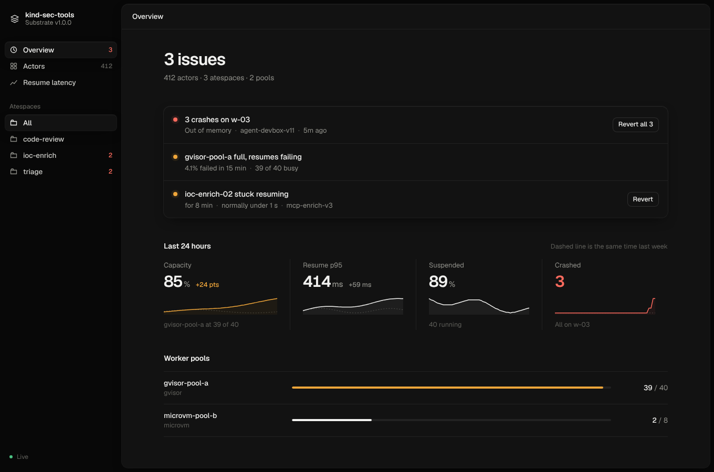

# substrate-console

A console for [Substrate](https://github.com/agent-substrate/substrate) clusters, built as an **MCP App**. The same binary is:

- an MCP server whose tools wrap the Substrate control API (`ateapi`), Kubernetes and Prometheus, and
- the interactive view those tools render in any host that supports MCP Apps (Claude, ChatGPT, VS Code), plus a small local web page for using it without an assistant.

It is an unofficial, personal project and is not affiliated with the Substrate maintainers.



## What it shows

The console is built around progressive disclosure:

1. **Issues.** Crashes grouped by shared cause (worker, node, template), actors stuck in a transition, failed golden snapshots, unavailable workers, short pools, and capacity at 95% or more.
2. **Vitals.** Capacity, resume p95, suspended share and crashes, each against the same time last week.
3. **Templates.** What people actually author. Each template shows its image, size, sandbox, golden snapshot, actors, and how it compares with its other versions on crashes and resume latency. Templates are immutable, so the creator makes new templates and next versions, pre-filled from the current one. The assistant can draft one from a description, and you review it in the form before anything is created.
4. **Actors.** State, crash reason, a plain hint (for example "Node heap is set to 4 GiB; the sandbox allows 2 GiB"), timeline, logs and snapshots.
5. **Ask.** Instead of general dashboards, the assistant answers the question and draws the chart with `query_metric`.

Every view can be scoped to the whole cluster or a single atespace. The scope only narrows what you see. What you can see and change is decided by Substrate, for whoever the console acts as: see [Who the console acts as](#who-the-console-acts-as).

## Quick start

```sh
make build                              # builds the view, then the Go binary
bin/substrate-console serve --demo      # http://127.0.0.1:7878, fake cluster
```

`--demo` starts a fake cluster from [substrate-fake](https://github.com/alee792/substrate-fake) on loopback and connects to it exactly as it would to a real one: ateapi over TLS, the Kubernetes API for WorkerPools, trust bundles and tokens, and Prometheus with the real PromQL engine. The demo has a few real problems in it (three OOM crashes on one node, an actor stuck resuming, a nearly full pool, a failed golden snapshot), so you can try everything without a Substrate install. Writes change the fake's state in memory.

Against a real cluster, the console uses your kubeconfig the same way `kubectl ate` does: it port-forwards to `ate-system/api`, trusts the cluster's ClusterTrustBundle, and mints a token for the `ate-client` ServiceAccount.

```sh
bin/substrate-console serve --context kind-dev --prometheus-url http://localhost:9090
```

| Flag | Meaning |
|---|---|
| `--demo` | Start and use a fake cluster (substrate-fake). |
| `--read-only` | Register only the read tools. |
| `--kubeconfig`, `--context` | Which cluster. |
| `--endpoint` | Dial ateapi directly instead of port-forwarding. |
| `--service-account` | `namespace/name` of your own ServiceAccount (or set `ATE_SERVICE_ACCOUNT`). The console uses your kubeconfig to get short-lived ateapi tokens for it, instead of for ate-client. |
| `--token-file` | The console's ateapi token, from a file reread on every call (`-` for stdin). |
| `--token-command` | A command that prints the console's ateapi token, rerun shortly before it expires. |
| `--atespaces` | Atespaces to show people who can't list atespaces, comma-separated. |
| `--prometheus-url` | Enables vitals history, baselines and `query_metric`. |
| `--addr` | Listen address for `serve` (default `127.0.0.1:7878`). |
| `--auth` | Require a token on `/mcp`. On by default when `--addr` isn't loopback. |
| `--auth-token-file` | The token `/mcp` requires (or set `SUBSTRATE_CONSOLE_TOKEN`). Without either, `--auth` generates one. |
| `--forward-token` | `serve`: act as each caller. `/mcp` requires the caller's own ateapi token and sends it on. |
| `--no-web-fonts` | Don't load Geist from Google Fonts; use system fonts. |

## Connecting an assistant

**stdio** (Claude Desktop, Claude Code, VS Code, Codex):

```json
{
  "mcpServers": {
    "substrate": { "command": "substrate-console", "args": ["mcp", "--context", "kind-dev"] }
  }
}
```

**Streamable HTTP**: run `substrate-console serve` and point the host at `http://127.0.0.1:7878/mcp`. `/mcp` always rejects cross-origin browser requests.

ChatGPT needs a public HTTPS URL, so put it behind a tunnel you control and turn on `--auth`. A tunnel connects from loopback, so the server can't tell it isn't you. With auth on, `/mcp` takes `Authorization: Bearer <token>`, or `?key=<token>` for hosts whose connector settings only take a URL. The query form can end up in proxy logs, so use the header where you can. `serve --auth` prints the page link as `/#token=…`. The fragment never reaches a server, and the page drops it from the address bar once read.

## Who the console acts as

Substrate doesn't use Kubernetes RBAC to decide who may do what. ateapi takes a bearer JWT from an issuer it trusts and checks the token's subject against its own [access policies](https://github.com/agent-substrate/substrate/blob/v1.0.0/docs/guides/authorization.md): owner or viewer on the whole cluster, or owner, editor or viewer on one atespace. The console's kubeconfig is used only for what lives in Kubernetes: the trust bundle, the port-forward, WorkerPools and worker pod logs.

By default the console mints a token for the shared `ate-client` ServiceAccount, as `kubectl ate` does. `ate-setup` makes that account a cluster owner, so anyone using the console is one too. The overview says so at the bottom. On a cluster only you use, that's fine. Otherwise:

- **Just you, as yourself.** `--service-account ate-users/alice`. The console asks Kubernetes, with your kubeconfig, for a 15-minute ateapi token for that ServiceAccount and renews it before it expires. Kubernetes RBAC decides who may get tokens for which ServiceAccount (`create` on `serviceaccounts/token`), and ateapi's access policies decide what the account may do. This works the same in the web page and when an MCP host runs the console on your machine. Besides `create` on `serviceaccounts/token` for your own account, your Kubernetes account needs `list` on `clustertrustbundles`, and in `ate-system` `get` on `services`, `list` on `pods`, and `get` and `create` on `pods/portforward` (or pass `--endpoint`). Worker pools and logs also need read access to `workerpools` and pod logs, but you only see them as a cluster-wide viewer anyway. If ateapi trusts your own identity provider, pass its token instead with `--token-command` (for example `gcloud auth print-identity-token`) or `--token-file`.
- **Shared, as each caller.** `serve --forward-token` makes `/mcp` require each caller's own ateapi token and send it to ateapi on every call. The console never falls back to its own identity. A caller who can't list atespaces sees the ones named with `--atespaces` (and any atespace a tool call names) that they can read. A caller who can't list workers doesn't see workers, pools, capacity or pool-wide metrics, since the console reads those with its own credentials. Logs need cluster-wide viewer access, since the console reads pods with its own credentials. Writes are checked by ateapi; a refused one says what you can't do.
- **Remote connectors** (claude.ai or ChatGPT calling the console over the internet) aren't supported yet. Those hosts have no kubeconfig and can only send a token from an identity provider. The plan is for the console to check that sign-in and then get a Kubernetes token for the person's ServiceAccount itself, so the outside token never reaches ateapi.

`serve --demo --forward-token` prints tokens for three demo people: the ate-client owner, a global viewer, and an editor of `triage` only.

Hosts that don't render MCP Apps (Claude Code's terminal UI today) still get every tool, because each tool also returns a readable text summary.

## MCP Apps and OpenAI extensions

The server implements the [MCP Apps extension](https://github.com/modelcontextprotocol/ext-apps) (`io.modelcontextprotocol/ui`, spec 2026-01-26), the OpenAI Apps SDK `openai/*` keys, and the [OpenAI MCP Extensions](https://github.com/openai/mcp-extensions/blob/main/docs/spec.md) that fit a console. Other hosts ignore the OpenAI keys.

**MCP Apps**

- **Views.** One self-contained HTML bundle, declared twice with `text/html;profile=mcp-app`: `ui://substrate-console/console.html` for the full console and `ui://substrate-console/card.html` for cards in a conversation. Both set `_meta.ui.csp` (`resourceDomains` for fonts only, no `connectDomains`) and `prefersBorder`.
- **Tools.** Tools with a view carry `_meta.ui.resourceUri` and `_meta.ui.visibility`, plus the deprecated flat `ui/resourceUri` key. Every tool sets `readOnlyHint`, `destructiveHint` and `openWorldHint`. `structuredContent` (with a `kind` field) drives the view; `content` is a text summary for the model.
- **View.** Follows the host's theme, style variables and safe-area insets. It navigates by calling tools through the host, and it keeps the model told what the user is looking at with `ui/update-model-context`. That context is background context (`audience: ["assistant"]`) with `structuredContent`. It polls only in full screen.

**OpenAI Apps SDK keys**

- `openai/outputTemplate`, `openai/widgetAccessible`, `openai/toolInvocation/invoking|invoked`, `openai/widgetCSP`, `openai/widgetPrefersBorder` and `openai/widgetDescription`.

**OpenAI MCP Extensions**

- **Display modes.** Each view resource sets `_meta["openai/ui"]`. The console prefers `fullscreen` and the card prefers `inline`, so ChatGPT picks the mode before the view loads. The view has no expand or collapse buttons, because the host provides them. An inline card's "Open console" link calls `requestDisplayMode` when the user clicks it.
- **Entrypoints.** `open_console` is the sidebar (`global`) entrypoint and `console_tab` is the thread entrypoint. There is one tool per entrypoint, and both accept `{}`, are app-only and carry a title and light and dark 20×20 icons. The overview is cached in `localStorage`, so the sidebar entrypoint paints at once and then refreshes.
- **Deep links.** The view reads `hostContext["openai/deepLink"].url` and routes these paths: `/`, `/actors`, `/actors/{atespace}/{name}`, `/atespaces/{atespace}` and `/latency`.
- **Composer @-mentions.** The server advertises `openai/mentions` with `searchTool: "search_mentions"` (in both `extensions` and `experimental`). The tool returns `resource_link`s to `substrate://actors/{atespace}/{name}` and `substrate://atespaces/{atespace}`, and resource templates make both readable.
- **Messages.** "Ask" sends `ui/message`. When the host advertises `openai/message`, the question lands in the composer as an editable draft (`send: false`) instead of sending at once.
- **Not used.** File entrypoints, file resources, form elicitation and WebMCP don't fit a cluster console. Structured settings may come later, once there are settings worth having.

**Writes.** Every write tool takes `dry_run`. The view always does a dry run first and shows what will change before applying it. `revert_actors` and `delete_actors` are marked destructive.

The local web page (`serve`, then open `/`) is itself a minimal MCP Apps host built on `AppBridge`: it reads the view resource over `/mcp`, applies the resource's CSP, and loads it into a sandboxed iframe. `?mode=inline&tool=get_actor&args={...}` previews the inline card.

## Tools

| Tool | Kind | What it does |
|---|---|---|
| `status` | read | What needs attention, vitals, pools, atespaces. |
| `list_actors` | read | Filter by atespace, state (including `stuck`), template, worker, idle time. |
| `get_actor` | read | One actor with timeline, recent logs, a hint and suggested actions. |
| `actor_logs` | read | Tail logs of a running actor. |
| `list_templates` | read | Templates: image, size, sandbox, golden snapshot, actors, crashes, resume p95. |
| `get_template` | read | One template, its actors, and how its versions compare. |
| `list_worker_pools` | read | Pools, readiness and busy workers. |
| `query_metric` | read | Resume p95, resume failure rate, crashes; by template, pool or atespace. |
| `suspend_actors`, `resume_actors` | write | |
| `revert_actors`, `delete_actors` | destructive | |
| `drain_worker` | write | |
| `create_template` | write | With `dry_run`, an editable draft; `from` makes the next version. |
| `create_actor` | write | A suspended actor from a template. |
| `delete_template` | destructive | |
| `open_console`, `console_tab` | app only | Sidebar and thread entrypoints in ChatGPT. |
| `search_mentions` | app only | Actor and atespace @-mentions in ChatGPT's composer. |

## Layout

```
cmd/substrate-console   CLI: mcp (stdio), serve (HTTP + web page), version
internal/mcpapp         MCP server, tools, MCP Apps / OpenAI metadata
internal/rules          turns a cluster snapshot into "what needs you"
internal/backend        Backend interface; ate talks to a cluster (real or substrate-fake)
internal/metrics        Prometheus querier
internal/shell          HTTP handler for /mcp and the web page
web/                    Preact view and shell; dist/ is committed and embedded
```

Requires Go 1.27 and Node 22. `make test` runs Go vet and tests plus the TypeScript check. CI also checks that `web/dist` matches a fresh build.

## Known gaps

The live backend is written against Substrate v1.0.0's API and has been checked on a kind cluster running it: connection (ClusterTrustBundle lookup and token minting), WorkerPools, the template version flow, revert, crash grouping by node and the Prometheus name probe all work. Still to check on a real cluster:

- `StateSince` for actors that aren't running is the last write to the record (`update_time`), or the crash time. ateapi bumps `update_time` on every write, snapshot reports included, so a suspended actor can look suspended for less time than it has been. For a stuck transition it is the last write the transition made, which is what the threshold wants. A running actor's time comes from its worker assignment.
- `drain_worker` end to end.
- kind's bundled Prometheus doesn't scrape worker-pool metrics, so capacity and running-actor history are unavailable there.

Access: dry runs don't know what you're allowed to do, so a dry run can succeed where the real call is refused. Reading your own role from `GetAtespaceAccessPolicy` would fix that. Groups aren't supported by Substrate yet.

Also not done yet: a full actor timeline (needs state-change events from Substrate), logs for actors that aren't running, and remote connectors (claude.ai, ChatGPT). The view bundle is about 400 KiB (110 KiB gzipped). Most of that is the MCP SDK and zod. The build drops zod's non-English error locales.

## License

Apache-2.0. See [LICENSE](LICENSE) and [NOTICE](NOTICE).
