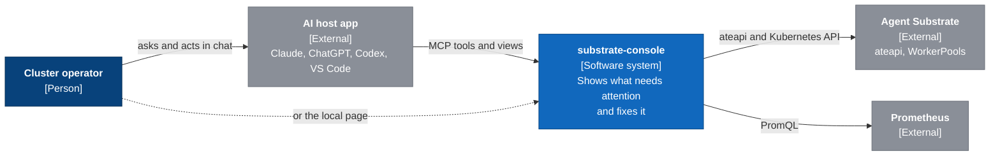
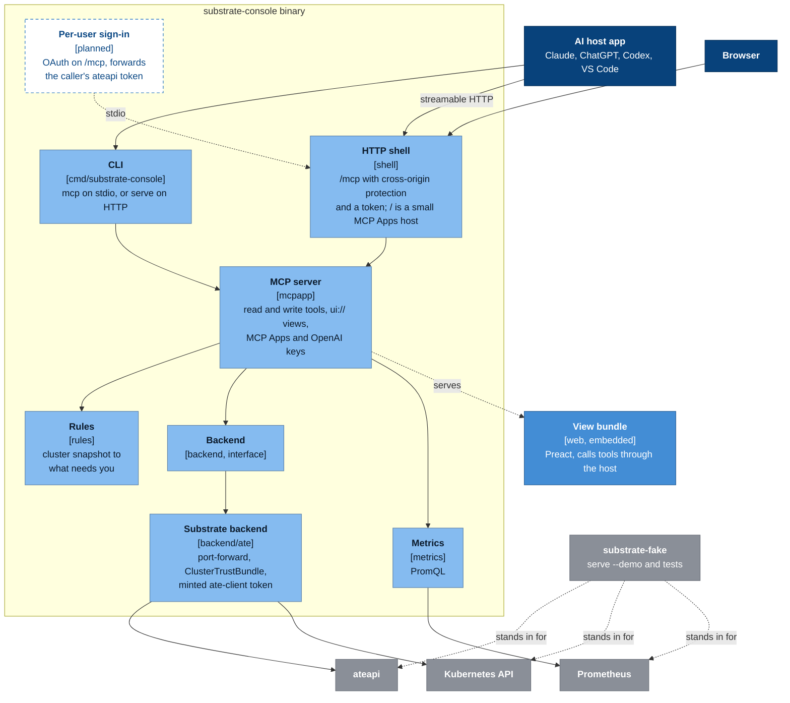
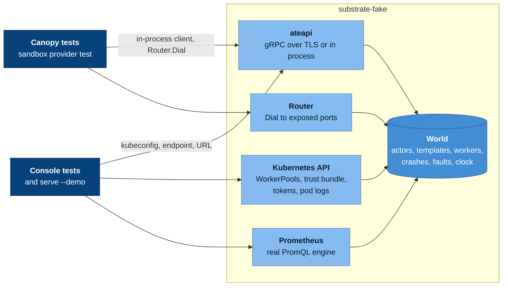

# Architecture

The diagrams follow the [C4 model](https://c4model.com). Dark blue is a
person, blue is ours, grey is someone else's, and a dashed box is planned.

## Context

The console is one Go binary. It is an MCP server whose tools wrap
Substrate's control API, Kubernetes and Prometheus, and it serves the view
those tools render. It runs inside an assistant (Claude, ChatGPT, Codex,
VS Code) or on its own local page. It knows nothing about agents; it is a
console for any Substrate cluster.

## Components

- **CLI** (`cmd/substrate-console`): `mcp` serves on stdio, `serve` on HTTP.
- **HTTP shell** (`internal/shell`): `/mcp` with Go's cross-origin
  protection and a bearer token off loopback, and `/`, a minimal MCP Apps
  host that loads the view into a sandboxed iframe.
- **MCP server** (`internal/mcpapp`): tools, `ui://` view resources, and the
  MCP Apps and OpenAI keys. Every write tool takes `dry_run`.
- **Rules** (`internal/rules`): turns a cluster snapshot into the issues
  list.
- **Backend** (`internal/backend`): the interface the tools use. The `ate`
  backend connects the way `kubectl ate` does: port-forward to
  `ate-system/api`, trust the ClusterTrustBundle, mint an `ate-client`
  token.
- **Metrics** (`internal/metrics`): Prometheus queries.
- **Per-user sign-in** (planned): OAuth on `/mcp`, forwarding the caller's
  own token so Substrate's access policies decide what they can see and do.
  Today every caller acts with the console's kubeconfig, and atespace scope
  only filters the view.

## Tests and demo

`serve --demo` and the tests run against
[substrate-fake](https://github.com/alee792/substrate-fake), which serves
ateapi over TLS, the Kubernetes API parts the console reads, and Prometheus
with the real PromQL engine, all from one in-memory world. Canopy's tests
use the same fake.

